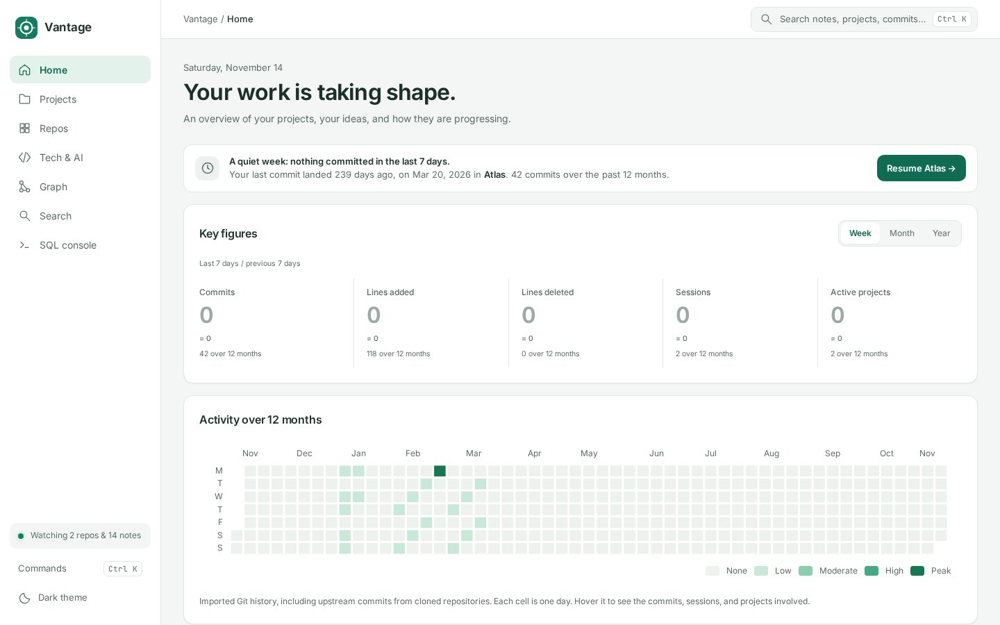
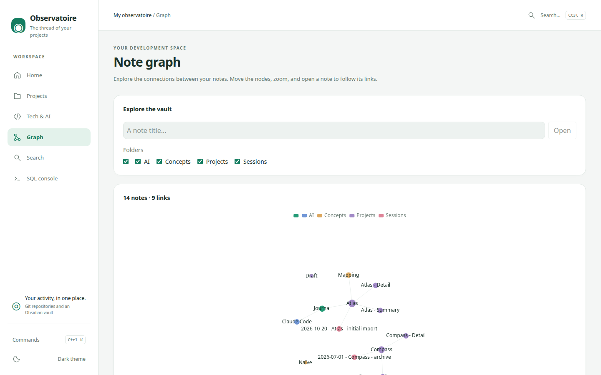
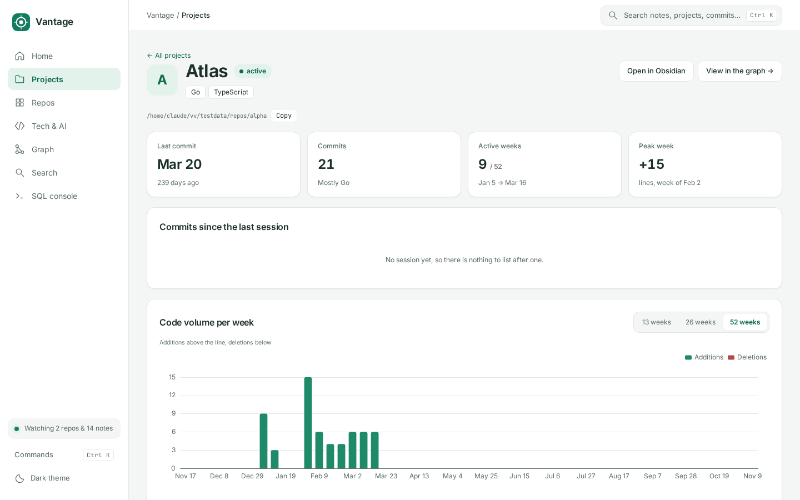

# Vantage

Vantage is a **local dashboard built for [Obsidian](https://obsidian.md)**. It runs on **Windows, Linux, and macOS**. It is not an Obsidian plugin and it does not run inside Obsidian. It reads the vault folder on disk, reads the Git repositories named by that vault's project cards, and shows the result at **http://127.0.0.1:7878**: history, languages, the note graph, search, and a SQL console.

It is for someone who already keeps project notes in Obsidian and wants those notes next to the commits of the repositories they describe.





The pictures are `testdata/vault` (Atlas and Compass), not a personal vault.

Nothing is uploaded. There is no telemetry. The network behavior, and the few files the program writes, are listed under [What it reads and writes](#what-it-reads-and-writes).

## What Obsidian features it uses

Vantage understands a vault the way Obsidian stores it on disk:

- A vault is a folder that contains `.obsidian`. Hidden directories, including `.obsidian`, are skipped.
- Notes are Markdown files. Properties are YAML between the opening `---` lines. [Dataview](https://github.com/blacksmithgu/obsidian-dataview) inline fields (`key:: value`) are not read. Templater, the core graph, and community plugins are not required and are not consulted.
- Links are Obsidian wikilinks (`[[Note]]`, `[[Note|alias]]`, `[[Note#heading]]`). Links inside fenced code are ignored. An embed of a non-Markdown file is ignored.
- The graph in the UI is Vantage's graph of those wikilinks. It is not `graph.json`.

Every Markdown note is imported for search, the graph, and broken links. The extension is matched without regard to case (`.md` and `.MD`). A file whose name starts with `.` is skipped. A **project** is a card at exactly `Projects/<Name>/<Name>.md`:

```markdown
---
type: project
status: in progress
source_path: C:\dev\my-project
technologies:
  - "[[Go]]"
---
# My project
```

`source_path` must be an absolute path to a Git repository. On Linux that looks like `/home/you/dev/my-project`, and on macOS like `/Users/you/dev/my-project`. Without it, the card is still a project and still has notes, and it has no commits. `status: in progress` is the exact string used to decide that a quiet project is dormant.

The sample Compass card still says `source_path: C:/Fixtures/Compass`. That folder is not a repository on Linux or macOS. `testdata/vault/.vantage/repos` maps the names Atlas and Compass onto `testdata/repos`, with paths relative to the vault, so `import` reads both histories on every OS. A hidden directory is not a note. See [Port and repository paths](#port-and-repository-paths).

Optional:

- `verified_commit` and `verified_on`, to spot a card that has fallen behind the repository. A value may start with a SHA (`0df64eb2 (upstream)`).
- Sessions: notes in `Sessions/` with `type: session`, `project: "[[Name]]"`, `date: YYYY-MM-DD`, and `ai: "[[Name]]"`.
- A `Journal.md` at the vault root. A line is kept when it matches `- YYYY-MM-DD - [[AI]] - text` or the same line with a `*` bullet. A line with an invalid date, or any other shape, is ignored.
- Optional `expected_notes` on a project card: a YAML list of note titles. Health warns only about titles in that list. An empty list, or a missing key, means no missing-note warning.
- Optional `branch` (used when a repository spec does not name its own branch; empty means `HEAD`) and `repos` (extra paths, or maps with `path` and `branch`).

A full fictional vault is in `testdata/vault` (Atlas and Compass). `import` does not modify notes. `report` does write one file; see below.

Git import follows **HEAD** of each repository (the current branch only). It is incremental. If that history is rewritten, the repository is read again from the start. Author **names** are stored. Author emails are not. Changed paths and line counts come from `git log --numstat`. Language totals come from [scc](https://github.com/boyter/scc), which counts lines and does not store source text.

## What it reads and writes

**Reads**

- Every Markdown file whose name does not start with `.` (`.md` and `.MD`; symlink notes are refused; hidden directories are still skipped).
- `git log` of `HEAD` for each absolute `source_path`, or for the path named in `<vault>/.vantage/repos` / `-repos` when that replaces it.
- A line count of the Git tree at the imported revision, for language statistics.

**Writes**

- `vantage.db`, plus `vantage.db-wal` and `vantage.db-shm`, in the current directory (or `-db`).
- `queries/*.sql` next to that database, when you save a query in the SQL console.
- `Statistics.md` at the vault root, only when you run `report`. The file is replaced atomically. An existing `Statistics.md` is overwritten only when its front matter says `generated_by: vantage` or `generated_by: observatoire`. The same words in the body do not count. There is no backup: copy the note first if you need the previous text. `report` does not create the vault directory; a missing vault is an error. The activity table compares the last 7 days with the 7 days before that.
- The vault path remembered by the start script: `%LOCALAPPDATA%\Vantage\vault.txt` on Windows, `$XDG_DATA_HOME/vantage/vault.txt` on Linux (`~/.local/share/vantage/vault.txt` when `XDG_DATA_HOME` is unset), and `~/Library/Application Support/Vantage/vault.txt` on macOS. If a path was stored under the previous Observatoire directory, the start script still reads it, warns, and then writes the Vantage location.

`build.ps1` on Windows may open an administrator prompt so Controlled Folder Access allows `vantage.exe` to create the database. That is a machine setting. `build.sh` on Linux and macOS does not change a security product.

## Supported platforms

| Platform | What CI runs |
|---|---|
| Windows 10 or later | Go tests, web unit tests, `install.cmd`, `build.cmd` |
| Linux | Go tests, web tests, Playwright end-to-end tests, `install.sh`, `build.sh`, `start.sh` |
| macOS | Go tests, web unit tests, `install.sh`, `build.sh`, `start.sh` |

The program is the same binary on each system. Paths inside a vault are stored with forward slashes. A `source_path` copied from Windows (`C:\...` or `C:/...`) is still recognized on Linux and macOS, and a path that starts with `/` is recognized on Windows, but Git can only read a repository that exists on the machine where Vantage is running.

## Requirements

| | Windows | Linux | macOS |
|---|---|---|---|
| Git | [Git for Windows](https://git-scm.com/download/win), or `winget install --id Git.Git -e` | `git` from the distribution | Xcode command line tools, or Homebrew `git` |
| Go | 1.26.11 (`go.mod`). `winget install --id GoLang.Go -e` | 1.26.11 from [go.dev/dl](https://go.dev/dl/) | 1.26.11 from [go.dev/dl](https://go.dev/dl/) or Homebrew |
| Node.js | 22.12 or newer. `winget install --id OpenJS.NodeJS.LTS -e` | 22.12 or newer from [nodejs.org](https://nodejs.org/) | 22.12 or newer from [nodejs.org](https://nodejs.org/) or Homebrew |

`install.cmd` installs anything missing through winget. `install.sh` installs Git through the system package manager (Homebrew on macOS) when the `git` command is missing, and downloads the official Go and Node.js builds into `~/.local/opt` when the copies on `PATH` are missing or older than the versions above. Add the printed `PATH` line to your shell profile if you want those copies in new terminals. The scripts find them on their own either way.

## Quick start (Windows)

Open **PowerShell** in this folder.

**0. Get the project** (once)

```powershell
git clone https://github.com/Anarchiejs/Vantage.git
cd Vantage
```

> No Git yet? `winget install --id Git.Git -e`, then close and reopen PowerShell.

**1. Install** — Git, Go, and Node (via winget if they are missing), then the dependencies

```powershell
.\install.cmd
```

**2. Build** — the UI, then `vantage.exe`

```powershell
.\build.cmd
```

If Windows Defender **Controlled folder access** is on, an administrator window may open to allow `vantage.exe`. Accept it, or the program cannot create its database. You can also keep the repository outside a protected folder, for example `C:\dev\Vantage`.

**3. Start** — import your Obsidian vault and open the UI. The path is the folder you open in Obsidian, not this repository.

```powershell
.\start.cmd "C:\Users\you\Documents\My Vault"
```

The browser opens **http://127.0.0.1:7878**. `Ctrl+C` stops the server. The path is remembered: next time, `.\start.cmd` is enough. Another port is `.\start.cmd -Port 8080`. To point a card at a repository on this PC, add `-Repos "Name=C:\path"`. Details are under [Port and repository paths](#port-and-repository-paths).

While `start.cmd` is running, an edited note or a new commit shows up within a few seconds. After a `git pull`, run `.\build.cmd` again.

## Quick start (Linux and macOS)

Open a terminal in this folder. The commands are the same on both systems.

**0. Get the project** (once)

```bash
git clone https://github.com/Anarchiejs/Vantage.git
cd Vantage
```

**1. Install** — Git, Go, and Node when they are missing or too old, then the dependencies

```bash
./install.sh
```

**2. Build** — the UI, then the `vantage` binary

```bash
./build.sh
```

**3. Start** — import your Obsidian vault and open the UI. The path is the folder you open in Obsidian, not this repository.

```bash
./start.sh "$HOME/Documents/My Vault"
```

The browser opens **http://127.0.0.1:7878** when a desktop session is available. Otherwise the script prints the address. `Ctrl+C` stops the server. The path is remembered: next time, `./start.sh` is enough. Another port is `./start.sh --port 8080`. To point a card at a repository on this machine, add `--repos "Name=/absolute/path"`. Details are under [Port and repository paths](#port-and-repository-paths).

While `start.sh` is running, an edited note or a new commit shows up within a few seconds. After a `git pull`, run `./build.sh` again.

`go build` without `-tags embed` reads `web/dist` from disk and only works when the current directory is the repository root. `./build.sh` passes `-tags embed`, so the binary can be started from any directory.

## Port and repository paths

`start.cmd` and `start.sh` listen on port **7878**. Pick another port when that one is taken:

```powershell
.\start.cmd -Port 8080 "C:\Users\you\Documents\My Vault"
```

```bash
./start.sh --port 8080 "$HOME/Documents/My Vault"
```

The same flags exist on the binary: `vantage serve -port 8080` and `vantage watch -vault <folder> -port 8080`.

A card's `source_path` is the repository on the machine that wrote the card. To point a card at a different folder, pass `-repos` / `-Repos` / `--repos`:

```powershell
.\start.cmd -Repos "Atlas=$PWD\testdata\repos\alpha,Compass=$PWD\testdata\repos\beta" testdata\vault
```

```bash
./start.sh --repos "Atlas=$PWD/testdata/repos/alpha,Compass=$PWD/testdata/repos/beta" testdata/vault
```

You can also put one `Name=path` pair per line in `<vault>/.vantage/repos`. A line starting with `#` is a comment. Paths in that file are relative to the vault. The sample vault includes this file, so `.\start.cmd testdata\vault` and `./start.sh testdata/vault` import both fixture repositories on Windows, Linux, and macOS. The start scripts create those repositories the first time they are missing. A name on the command line replaces the same name from the file. `import` and `watch` read the file too, so the flag is optional for that vault.

## Commands

| Command | Role |
|---|---|
| `import -vault <folder>` | import the vault and the Git repositories |
| `serve` | serve the UI on 127.0.0.1 (no vault; uses the existing database) |
| `report -vault <folder>` | write `Statistics.md` at the vault root |
| `migrate` | create or update the schema (also done by the other commands) |
| `watch -vault <folder>` | import, serve, and reimport when a note or a repository changes |

| Option | Commands | Default |
|---|---|---|
| `-db <file>` | all | `vantage.db` in the current directory |
| `-vault <folder>` | `import`, `watch`, and `report` (unless `-stdout`) | required on the binary; `start.cmd` and `start.sh` remember it and pass it |
| `-repos "Name=folder,…"` | `import`, `watch` | replaces `source_path` for the named cards. Also loaded from `<vault>/.vantage/repos` when that file exists |
| `-port <n>` | `serve`, `watch` | `7878` |
| `-stdout` | `report` | print the report instead of writing it |

```bash
./vantage report -vault "$HOME/Documents/My Vault"
./vantage report -stdout
```

**SQL console:** read-only (no writes, no `ATTACH`, no `PRAGMA` that changes the connection, no transaction), 5 seconds, 1000 rows, and at most two queries at once. The server accepts only local requests. Details are in [SECURITY.md](SECURITY.md).

Deleting `vantage.db` is safe. The next import rebuilds it from the vault and the repositories. Do not delete the vault. A file still named `observatoire.db` is refused: rename it, and the `-wal` and `-shm` companions, to `vantage.db` (or pass `-db` after renaming). If `observatoire.db` sits next to a missing `vantage.db`, Vantage does not create an empty database.

## Upgrading an older database

The schema, the vault keys, and the CLI were renamed from French to English by editing the first two migration files in place. Goose will not rebuild a database that already applied those versions, and Vantage refuses to open a file that still contains a table named `projet`.

Delete `vantage.db`, `vantage.db-wal`, and `vantage.db-shm`, update the cards using the table in [CHANGELOG.md](CHANGELOG.md), then import again. A database file still named `observatoire.db` is refused: rename it, and the `-wal` and `-shm` companions, to `vantage.db`. A remembered vault path still stored as `Observatoire/vault.txt` is read once, with a warning, and then written to the Vantage location; the old file is not deleted. Move `<vault>/.observatoire/repos` to `<vault>/.vantage/repos` (the old file is still read, with a warning). The remembered Windows path also moved from `coffre.txt` to `vault.txt`.

## Common problems

| Message | What to do |
|---|---|
| `-vault is required` | Pass the folder you open in Obsidian. |
| `retired French schema` | Delete the database and its `-wal` and `-shm` files, then import again. See [CHANGELOG.md](CHANGELOG.md). |
| `unable to open database file (14)`, or the server stops immediately | On Windows, Defender is blocking `vantage.exe`. Run `.\build.cmd` again and accept the administrator window, or allow the program in *Windows Security › Virus & threat protection › Manage ransomware protection › Allow an app*. Or move the repository out of a protected folder. |
| `… was not found` / `was just installed but is still not found` | Close and reopen PowerShell, then run the script again. |
| `winget was not found` | Install "App Installer" from the Microsoft Store. |
| `On Windows, run install.cmd` | A `.sh` script was started from Git Bash. Use `install.cmd`, `build.cmd`, or `start.cmd` in PowerShell. |
| `Go … is older than go.mod` / `Node … is older than 22.12.0` | On Linux or macOS, run `./install.sh` again. It places a current Go or Node under `~/.local/opt` and the scripts prefer that copy. |
| Browser did not open | On Linux without a graphical session the script prints the URL. Open http://127.0.0.1:7878 yourself. |
| `folder not found` | Check the vault path and quote it. |
| `no Git repository imported` / `0 repositories` | No `Projects/<Name>/<Name>.md` card with `type: project` and a repository that exists on this machine. Pass `--repos` / `-Repos`, or add `<vault>/.vantage/repos`. |
| `warning: <Project> (<path>): git rev-parse` | That `source_path` is not a Git repository. The other projects are still imported. |
| `listen tcp 127.0.0.1:7878: bind` | The port is taken. Stop the other process, or `./start.sh --port 8080` (`.\start.cmd -Port 8080` on Windows). |

## Develop

See [CONTRIBUTING.md](CONTRIBUTING.md). Short form:

```bash
./install.sh                      # Linux and macOS; Windows: .\install.cmd
./build.sh                        # Linux and macOS; Windows: .\build.cmd
npm --prefix web run dev          # Vite; /api is proxied to http://127.0.0.1:7878
npm --prefix web run dev:mock     # no Go server; responses come from web/public/mocks
go test ./...                     # creates testdata/repos when they are missing
go run ./scripts/fixtures/make-repos.go   # rebuild those repositories
```

Playwright end-to-end tests run in CI on Linux (`npm --prefix web run e2e`). Web unit tests run in CI on Linux, macOS, and Windows.

Schema changes are new files in `migrations/`. SQL is compiled with sqlc 1.31.1. Do not edit `internal/sql/gen` by hand.

## Layout

```
cmd/vantage/   entry point (import, serve, watch, report, migrate)
internal/api/       HTTP server: JSON views, SQL console, SSE, UI
internal/db/        SQLite and migrations
internal/ingest/    import: git/, code/ (languages via scc), vault/
internal/report/    Statistics.md
internal/sql/       sqlc queries and generated code (gen/)
internal/watch/     vault and repository watching (fsnotify)
migrations/         SQL schema (goose)
scripts/            install, build, start (PowerShell and bash), fixtures/
testdata/           fictional vault; repos/ is generated and gitignored
web/                React + Vite UI
```

## License

[MIT](LICENSE). Copyright (c) 2026 [Anarchy](https://github.com/Anarchiejs). Third-party licenses are listed in [NOTICE](NOTICE).
